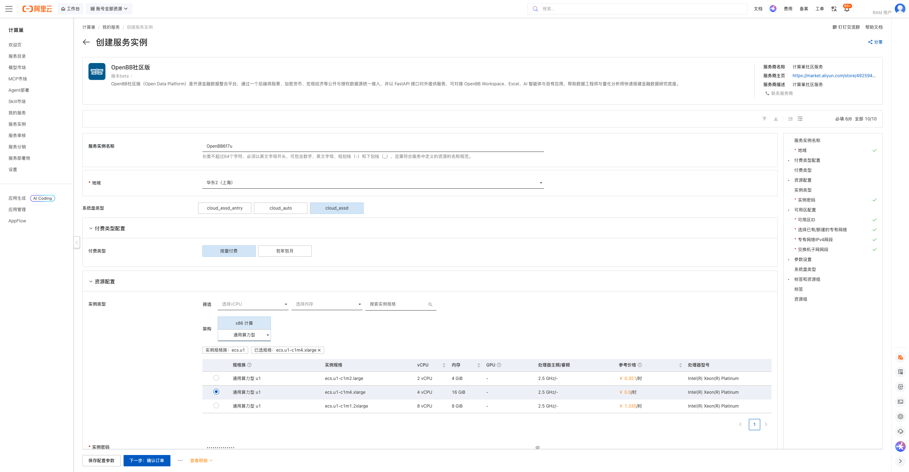
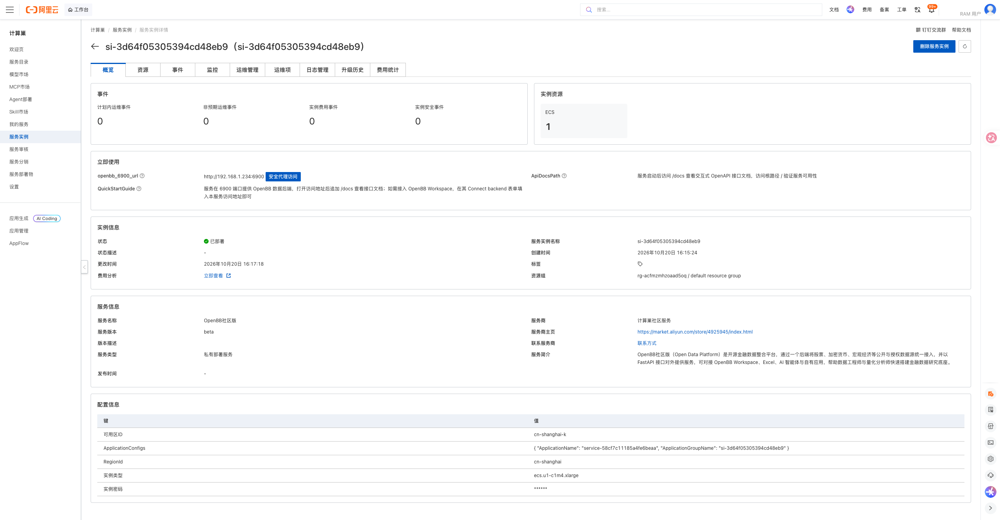
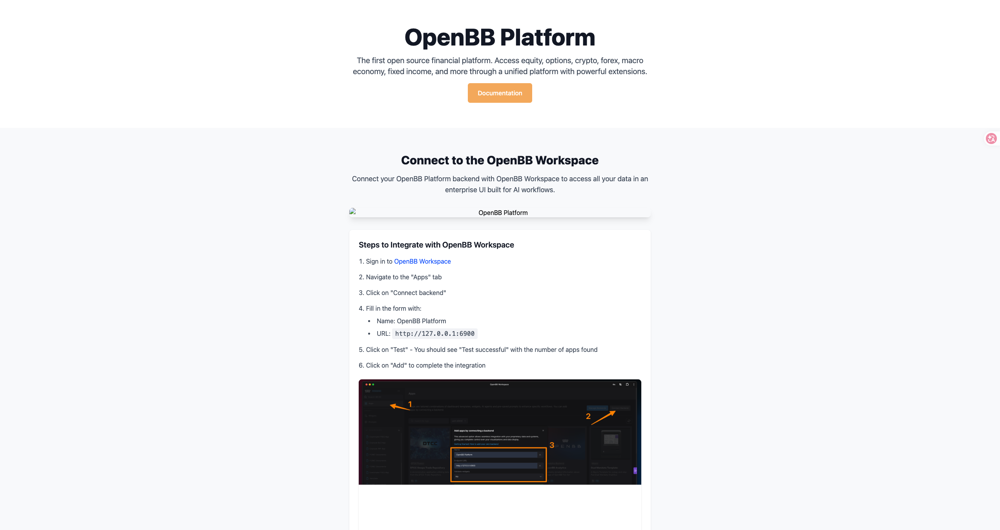

# OpenBB 计算巢部署文档

## 概述

[OpenBB](https://github.com/OpenBB-finance/OpenBB) 是开源金融数据整合平台（Open Data Platform），通过一个后端将股票、加密货币、宏观经济等公开与授权数据源统一接入，以 FastAPI 接口对外提供服务，可对接 OpenBB Workspace、Excel、AI 智能体与自有应用。本方案将其部署在用户自己的 ECS 中。

| 项目 | 说明 |
| --- | --- |
| 服务 ID | `service-58cf7c11185a4fe6beaa` |
| 部署形态 | 单台 ECS + Docker Compose |
| 访问方式 | 计算巢安全代理（内网直达，不暴露公网端口） |
| 应用端口 | 6900（REST API，`/docs` 为接口文档） |
| 实测部署耗时 | 约 2 分钟 |

## 部署步骤

### 1. 打开创建页面

访问 [OpenBB 服务实例创建页](https://computenest.console.aliyun.com/service/instance/create/cn-hangzhou?type=user&ServiceId=service-58cf7c11185a4fe6beaa)。

### 2. 配置部署参数

| 参数 | 说明 | 建议 |
| --- | --- | --- |
| 服务实例名称 | 控制台中用于识别本次部署 | 保持默认或自定义 |
| 地域、可用区 | ECS 所在位置 | 选择接近使用者且有库存的地域和可用区 |
| 付费类型 | 按量付费或包年包月 | 测试使用按量付费 |
| 实例类型 | ECS 规格 | 提供 3 种通用算力型 u1 规格 |
| 实例密码 | ECS 登录密码 | 使用符合页面规则的强密码 |
| 专有网络 | 新建或复用 VPC | 首次部署可选择新建 |
| VPC/交换机网段 | 网络地址范围 | 无冲突时保持默认 |
| 系统盘类型 | ECS 系统盘 | 默认 `cloud_essd` |

本服务无额外业务必填参数；付费数据源的凭据可在部署后按需配置。

填写完成并看到询价结果后，点击“下一步：确认订单”，核对资源和费用，勾选服务协议并创建实例。

### 3. 等待部署完成

进入服务实例详情页，等待状态变为“已部署”。本次实测从创建到部署完成约 2 分钟。

### 4. 进入应用

在实例详情页点击「安全代理访问」，通过计算巢内网 Web 链路直达应用，无需放行公网端口。

通过安全代理地址访问 6900 端口数据后端，访问地址后追加 `/docs` 查看自动生成的接口文档；接入 OpenBB Workspace 时，在其 Connect backend 表单填入本服务访问地址即可。

## 数据与安全

- 实例通过计算巢安全代理访问，安全组仅对计算巢链路网段开放，不暴露公网端口。
- 各数据源凭据保存在你自己的实例中。
- 数据缓存与配置均在实例本地；删除实例前请备份需要保留的内容。

## 资源释放

不再使用时，在计算巢服务实例详情页执行“删除”。删除完成后建议继续确认：

1. 服务实例已不存在；
2. ROS 资源栈状态为 `DELETE_COMPLETE`；
3. ECS、VPC、交换机和安全组均无残留；
4. 账单中不再产生相关按量资源费用。

删除服务实例会同时删除 ECS 及其本地数据，请提前导出或备份重要文件和配置。

## 官方链接

- [OpenBB 官方仓库](https://github.com/OpenBB-finance/OpenBB)
- [OpenBB 官方文档](https://docs.openbb.co/)

- [阿里云计算巢文档](https://help.aliyun.com/zh/compute-nest/)
